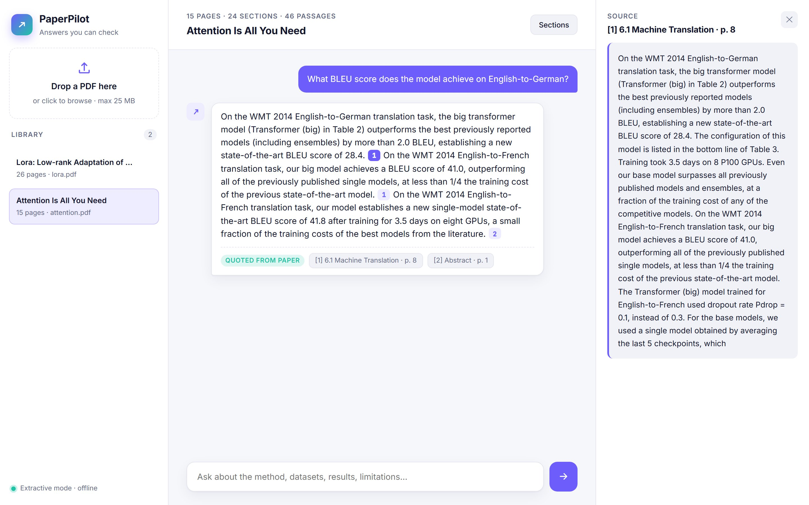
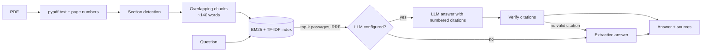

<div align="center">

# ✈️ PaperPilot

**Ask questions about research papers and get answers you can check, each one cited to the exact section and page.**

[](https://github.com/Mahima1810/paperpilot/actions/workflows/ci.yml)




</div>

## Why

LLM tools that "chat with your PDF" often sound confident and are hard to verify. PaperPilot is built around one rule: **if an answer can't point to a passage in the paper, it isn't shown.**

## Features

- **PDF parsing with section detection.** It recognises numbered headings ("3.2 Attention"), small-caps headings and common unnumbered ones (Abstract, Limitations…), and tracks page numbers for every passage.
- **Hybrid retrieval.** BM25 and TF-IDF (with bigrams) are merged with reciprocal rank fusion. It runs on CPU, offline, with no model download.
- **Citation-grounded answers**:
  - **LLM mode** works with any OpenAI-compatible API (OpenAI, Groq, OpenRouter, or a local Ollama). Citations to passages that don't exist are removed. An answer with no valid citation is thrown away.
  - **Extractive mode** is the default and needs no API key. It quotes the most relevant sentences directly from the paper.
  - **Refusal.** If nothing relevant is retrieved, it says *"I couldn't find this in the document."*
- **Bibliography-safe.** The paper's own reference markers like `[20]` are rewritten to `(ref. 20)`, so they're never confused with PaperPilot's citations.
- **Clean web UI.** Drag-and-drop upload, a paper library, clickable citation chips that open the source passage, a dark mode, and a responsive layout.
- **REST API** with interactive docs at `/docs`.

## How it works



## Quick start

```bash
git clone https://github.com/Mahima1810/paperpilot.git
cd paperpilot
python -m venv .venv && source .venv/bin/activate   # Windows: .venv\Scripts\activate
pip install -r requirements.txt
uvicorn app.main:app --reload
```

Open http://localhost:8000 and drop in a PDF. API docs are at http://localhost:8000/docs.

### Optional: LLM mode

Copy `.env.example` to `.env`, or set these variables:

| Variable | Example | Notes |
|---|---|---|
| `LLM_MODEL` | `gpt-4o-mini`, `llama-3.1-8b-instant`, `llama3.2` | Leave empty for extractive mode |
| `LLM_BASE_URL` | `https://api.openai.com/v1`, `https://api.groq.com/openai/v1`, `http://localhost:11434/v1` | Any OpenAI-compatible endpoint |
| `LLM_API_KEY` | `sk-...` | Not needed for local Ollama |

### Docker

```bash
docker build -t paperpilot .
docker run -p 8000:8000 -v paperpilot-data:/app/data paperpilot
```

## API

| Method | Path | Description |
|---|---|---|
| `POST` | `/api/documents` | Upload a PDF (multipart `file`). Identical files are de-duplicated. |
| `GET` | `/api/documents` | List papers |
| `DELETE` | `/api/documents/{id}` | Remove a paper |
| `POST` | `/api/documents/{id}/ask` | `{"question": "...", "top_k": 5}` returns the answer, mode and citations |
| `GET` | `/api/health` | Server status and answer mode |

## Testing

```bash
pip install -r requirements-dev.txt
pytest          # 19 tests: parser, retrieval, citation checks, LLM fallback, API flow
ruff check .
```

The tests use a small, generated sample paper (`scripts/make_sample_pdf.py`) and a fake LLM client, so they run offline and give the same result every time. I also checked the pipeline by hand on two arXiv papers (LoRA and *Attention Is All You Need*), and the problems that check found are fixed.

## Limitations

- Scanned PDFs (images without a text layer) are not supported yet, because there's no OCR.
- Two-column layouts sometimes interleave lines across columns, which can blur passage boundaries.
- Retrieval is lexical. Questions phrased very differently from the paper's wording may miss; dense embeddings are on the roadmap.
- Extractive mode quotes sentences; it does not summarise or reason across passages.

## Roadmap: good first contributions

- [ ] Optional dense-embedding retriever (sentence-transformers) fused into RRF
- [ ] OCR fallback for scanned PDFs (Tesseract)
- [ ] Highlight the cited passage inside an embedded PDF viewer
- [ ] Multi-paper questions ("compare the datasets used in A and B")
- [ ] Evaluation set of question/answer/page triples with a retrieval-accuracy report
- [ ] Streaming LLM responses

## Contributing

Contributions are welcome! See [CONTRIBUTING.md](CONTRIBUTING.md). Open an issue first for larger changes.

## About

Built in November 2026 by [Mahima Kopalley](https://github.com/Mahima1810) with AI-assisted development (Claude). Design decisions, testing and review are my own; issues and pull requests are welcome.

## License

[MIT](LICENSE)
